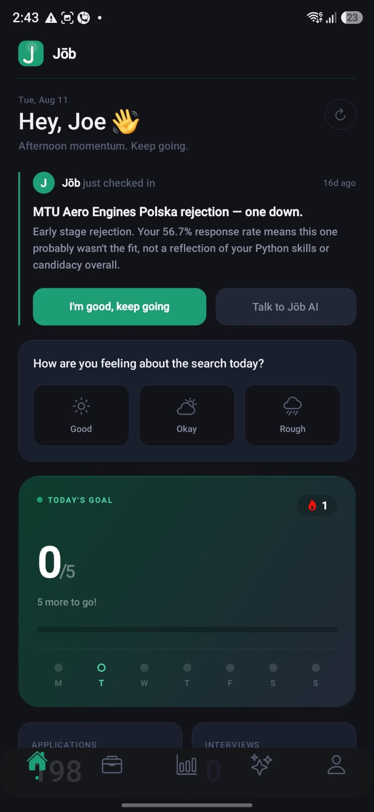
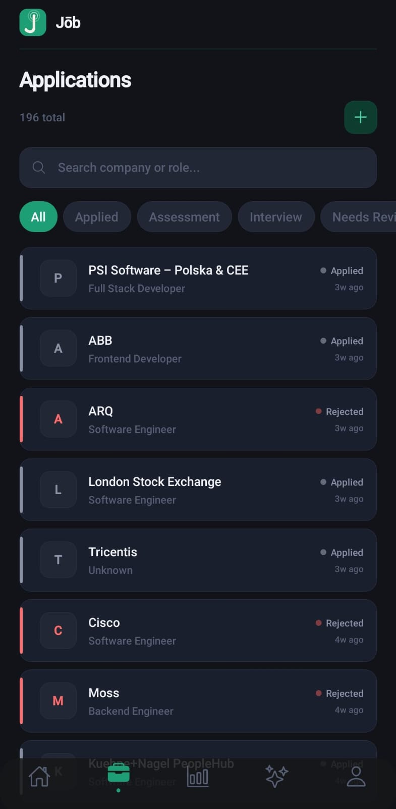
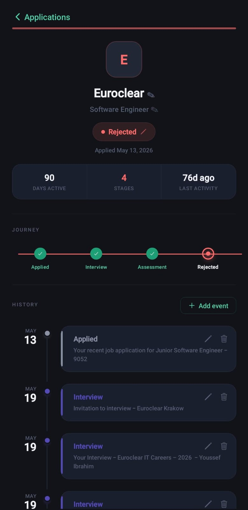
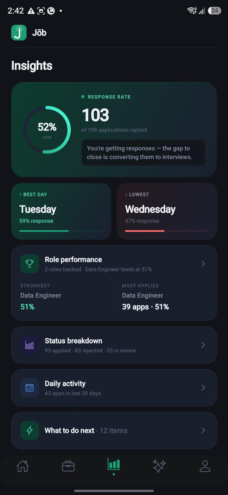
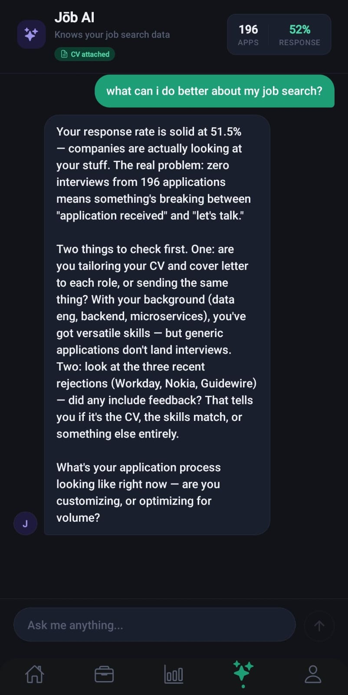
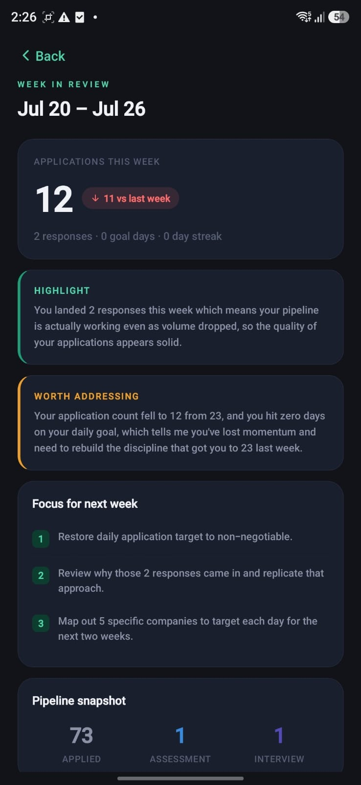
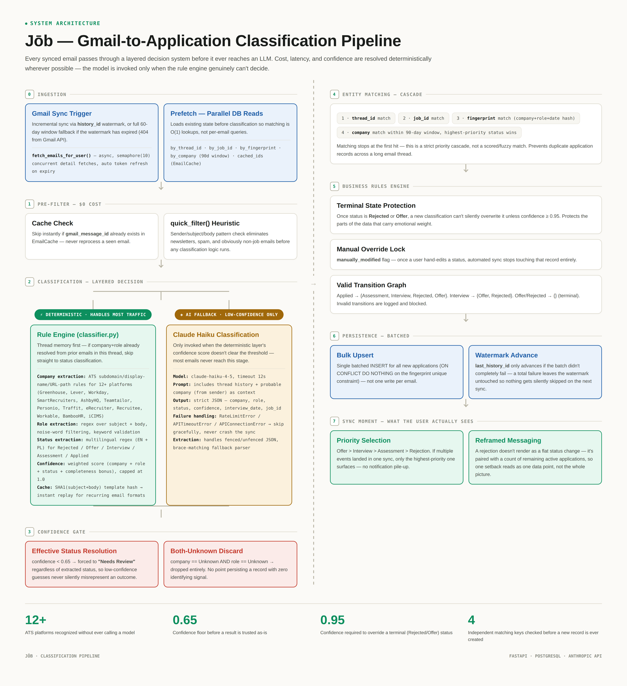

# Jōb

A job search companion app. It reads your Gmail, figures out what happened with each application, and tracks everything automatically instead of you updating a spreadsheet by hand.

Live on Google Play: play.google.com/store/apps/details?id=com.youssefibrahim.job

Built solo. React Native/Expo on the frontend, FastAPI and PostgreSQL on the backend, Anthropic's Claude API doing the classification work.

## Screens

### Home

The main dashboard. Shows today's application count, response rate, and a rotating "companion" card that reacts to whatever happened most recently in your inbox. This is the first thing you see, so it's designed to answer "where do I actually stand right now" in one glance, without needing to dig through a list.

### Applications list

Every tracked application, each with its current status (Applied, Interview, Assessment, Offer, Rejected). Every entry here got there automatically from a Gmail sync, not a manual add.

### Application detail

A single application's full timeline: when you applied, every status change since, and the underlying email history that led to each change.

### Insights

Aggregate stats: response rate, best/worst days to apply, which roles are actually converting versus which ones you're applying to most.

### AI companion

A chat interface with access to your actual application data, not generic career advice.

### Weekly review

A weekly summary: applications sent, responses received, and an honest note about momentum if volume dropped compared to the week before.

## Data model

The core entities and how they relate:

- **User** — one row per account. Holds the Gmail OAuth refresh token and `last_history_id`, the watermark used for incremental Gmail sync.
- **Application** — the central record. Belongs to a User, and carries `company`, `role`, `status`, plus three separate matching keys used during sync: `thread_id`, `job_id`, and a `fingerprint` (a hash of company + role + date). Also carries a `manually_modified` flag and a `confidence` score from the classifier that produced it.
- **ApplicationEvent** — a one-to-many history log against Application. Every status change, whether from an automated sync or a manual edit, is appended here rather than overwriting the parent record, which is what powers the timeline view on the detail screen.
- **EmailCache** — one row per processed Gmail message ID, scoped to a User. Exists purely so a sync never reclassifies an email it's already seen.
- **Goal / Streak** — daily application-count targets and the current streak, referenced from the Home and Weekly Review screens.
- **Subscription** — Pro tier entitlement state, synced from RevenueCat via webhook.

## Core logic: how it reads your inbox

Most tools like this would throw every email at an LLM and let it sort things out. That's slow, it's expensive at any real scale, and it doesn't actually prove you understand the problem you're solving.

I built it differently. Before anything touches a model, most emails get resolved by a layered, deterministic system:

1. **A cheap filter kills the obvious noise first.** Newsletters, spam, anything clearly unrelated to a job application never gets any further processing. This costs nothing and runs instantly.

2. **A rule engine handles the majority of what's left.** Pattern-matching logic for 12+ ATS platforms (Greenhouse, Lever, Workday, SmartRecruiters, and others), extracting company, role, and status from how each platform actually structures its emails. Status detection uses multilingual regex, since rejection and interview language doesn't only show up in English. Every extraction gets a confidence score, weighted across company, role, status, and completeness. There's a template cache so a recurring email format from the same ATS gets classified instantly on repeat.

3. **Claude only gets called when the rule engine genuinely can't decide.** If confidence doesn't clear a threshold, the email goes to the model with the thread history as context. Most emails never reach this step at all.

Deciding when a model is worth calling, and building something reliable enough that it usually doesn't need to be, was the actual engineering problem here.

## Business logic: matching and status protection

- **Entity matching cascade.** An incoming classified email is matched against existing applications in priority order: thread ID first, then job ID, then the company+role+date fingerprint, then a recency-based company match. Matching stops at the first hit, so the same application never gets duplicated across a long email thread.
- **Terminal state protection.** Once an application is marked Rejected or Offer, a new classification can't silently overwrite it unless confidence is very high. Status changes that carry emotional weight don't get flipped by a low-confidence misread.
- **Manual override lock.** Once a user hand-edits a status, automated sync stops touching that record entirely.
- **Valid transition graph.** Status changes are only allowed along defined paths (Applied → Interview/Assessment/Rejected/Offer, etc.); anything outside that graph is logged and blocked rather than applied.

## Stack

- **Mobile:** React Native, Expo
- **Backend:** FastAPI, PostgreSQL, async SQLAlchemy
- **AI:** Anthropic API (Claude Haiku for classification and coaching)
- **Auth:** Google OAuth, Gmail API integration
- **Payments:** RevenueCat
- **Infra:** Railway, GitHub Actions