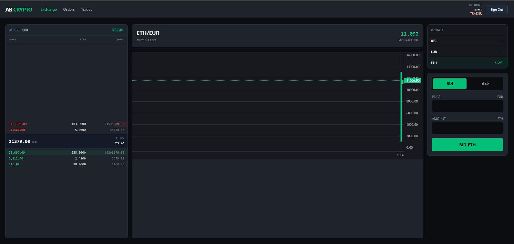

# Orderbook (AB CRYPTO)

A crypto exchange trading platform: order placement, a real matching engine, and trade settlement, built as six independent services communicating almost entirely through Kafka rather than direct calls to each other.

## Screen

The trading view: a live order book (bids and asks with price/size/total), a depth chart, and a bid/ask ticket. This is fed by the matching engine's real-time depth broadcast, described below.

## Service boundaries

Six services, five of them wired into a working flow:

| Service | Owns | Database |
|---|---|---|
| **gateway** | Pure reverse proxy. Routes `/v1/{auth,orders,engine,trades}/**` to the right container. No business logic, no auth enforcement of its own. | none |
| **auth-service** | User identity, JWT issuance, role management. | `user_db` |
| **order-service** | Order lifecycle system of record: place, cancel, history. Publishes events, never calls the matching engine directly. | `order_db` |
| **matching-engine-service** | The in-memory order book, the matching algorithm, live depth broadcast. | `order_db` (shares the physical container with order-service, but only reads/writes its own Instrument table there) |
| **trade-service** | Trade history ledger and fee calculation (0.1% flat, both sides). | `trade_db` |
| **transaction-service** | Scaffolded but not wired in. Its build file already pulls in MongoDB, Kafka, and Spring AI with Vertex AI Gemini, a different stack from everything else, which points at a planned AI-assisted settlement or ledger feature that was never built out. | — |

There is no REST traffic between backend services at all. Every cross-service interaction is either client → gateway → service, or service → Kafka → service. That was a deliberate choice, not an oversight: it means order-service and the matching engine can be deployed, restarted, or scaled independently without either one holding a live connection to the other.

## Order lifecycle

1. A client places an order through the gateway. **order-service** validates it, persists it as `PENDING`, and publishes an `OrderEventDto` to the `orders.created` Kafka topic. It never talks to the matching engine directly.
2. **The matching engine** consumes that event and runs it against an in-memory order book: a `ConcurrentSkipListMap<price, queue-of-orders>` per instrument, one for bids sorted highest-first and one for asks sorted lowest-first. Matching is genuine price-time priority: it walks the opposite side's best price level and drains that level's queue in arrival order.
3. On a partial fill, the resting order's remaining quantity is decremented in place rather than removed and re-inserted, so it keeps its position at the front of the queue. Any quantity the incoming order couldn't fill gets written back onto its own side of the book as a new resting order.
4. A match publishes a `TradeEventDto` to `trades.executed`. Two independent consumers read that same event: **trade-service** records the trade and calculates fees, and **order-service** updates both orders' fill status back to `PARTIALLY_FILLED` or `FILLED`. Neither service calls the other directly, they both just react to the same Kafka message.
5. Live depth (aggregated price levels, not individual orders) is pushed to connected clients once a second over STOMP, which is what actually drives the order book screenshot above.

## What I'd flag honestly about the current design

A portfolio should show engineering judgment, not just a feature list, so here's what I know is incomplete rather than glossing over it:

- **No idempotency on trade events.** Kafka delivery here is at-least-once (default Spring Kafka behavior, nothing custom configured), and neither consumer of `trades.executed` guards against processing the same message twice. A redelivery would duplicate a trade record or double-count a fill. The real fix is a dedup check keyed on trade ID, or a unique DB constraint, I know exactly what's missing and why.
- **No book persistence or replay.** The order book lives entirely in memory. A service restart silently loses every resting order, with no snapshot or event-sourced rebuild. That's a real gap for anything beyond a demo environment.
- **One stale integration point.** The frontend subscribes to a live trade-print feed that the backend never actually publishes to, only the depth feed is wired up. Left as-is rather than quietly removed, since it's a useful, honest example of the gap between "designed" and "fully wired."

## Infrastructure

Provisioned with Terraform: a single EC2 instance running every service as a Docker container via docker-compose, with one ECR repository per service and IAM scoped to ECR read-only. No load balancer, no managed database, everything (including Postgres and Kafka) runs on that one box, an intentionally minimal setup for a coursework-scale deployment, not a production topology.

CI/CD runs on Jenkins: a dev pipeline that runs the Maven test suite and does a shadow build of every service's Docker target on each commit, and a separate prod pipeline that builds, pushes to ECR, and redeploys over SSH.

## Stack

- **Backend:** Java, Spring Boot, Spring Cloud Gateway, Apache Kafka
- **Frontend:** React, STOMP over WebSocket for live depth
- **Data:** PostgreSQL (three logical databases across one container)
- **Infra:** Terraform, AWS (EC2, ECR, IAM), Jenkins, Docker Compose