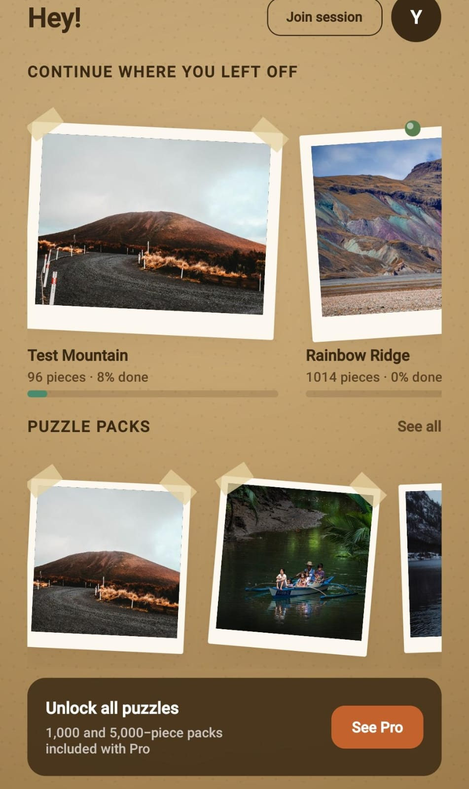
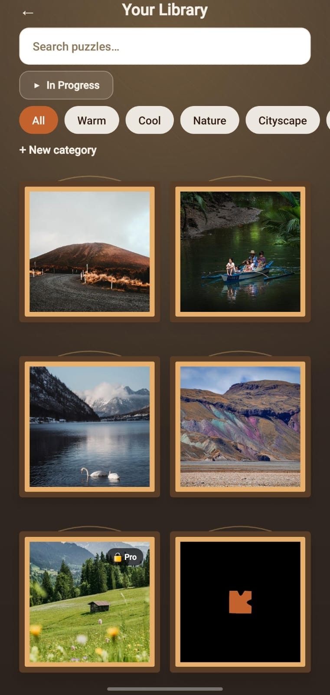
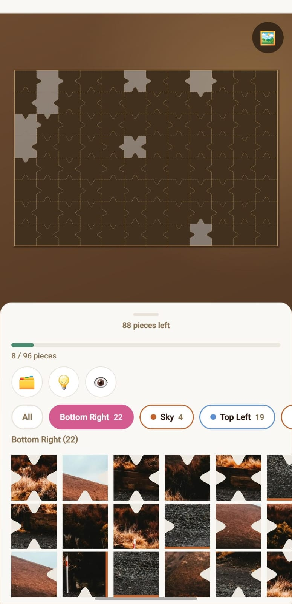
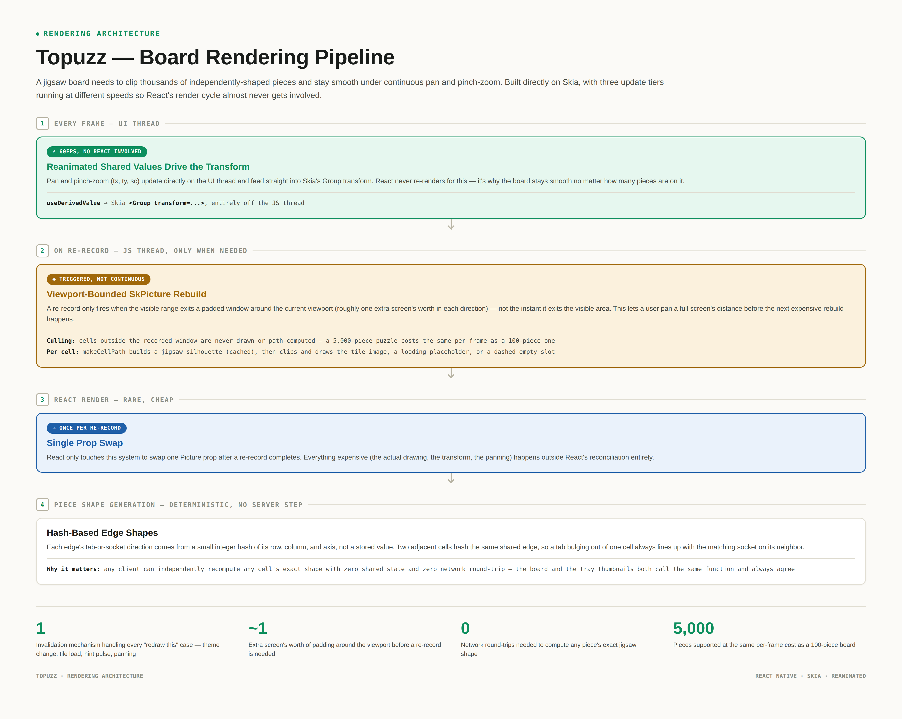
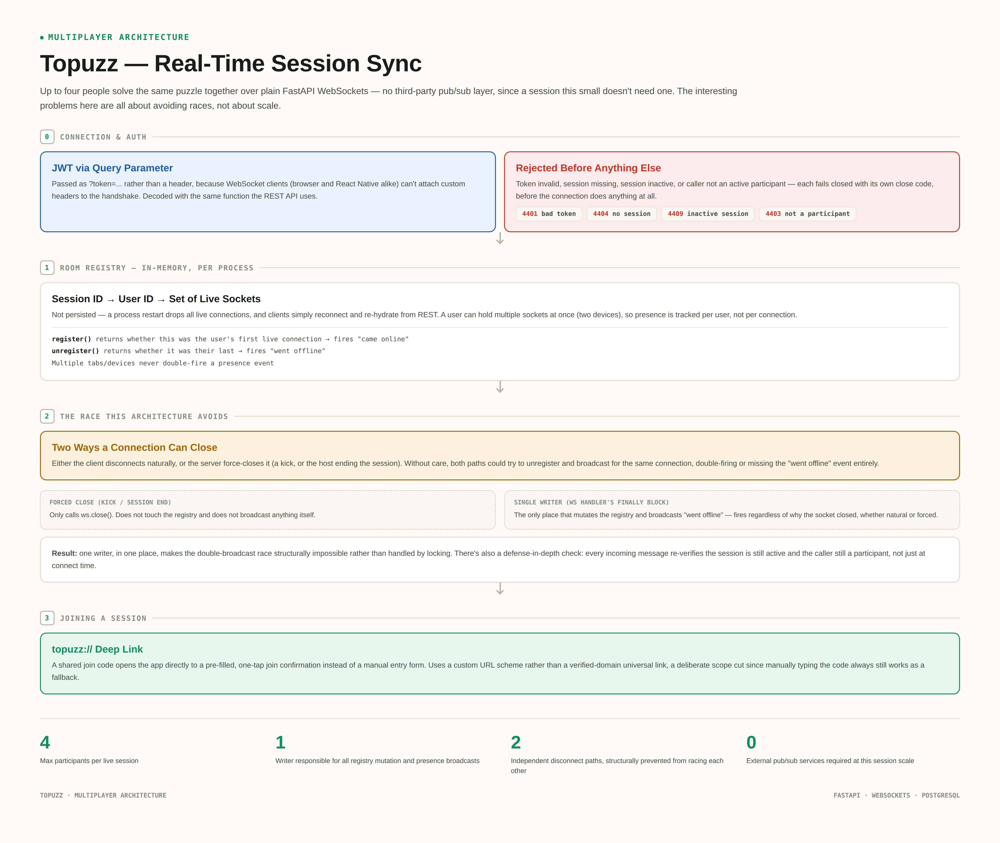

# Topuzz

*A portfolio overview of a production app. This is a showcase of the concept, architecture, and engineering decisions, not setup documentation, since the app has paid Pro features and the source lives in a private repository.*

A mobile jigsaw puzzle app. Puzzles up to 5,000 pieces, real-time collaborative solving with friends, and a custom-built rendering engine underneath, since nothing off the shelf could handle a jigsaw board at that scale smoothly.

Built solo. React Native/Expo on the frontend, FastAPI and PostgreSQL on the backend.

## Screens

### Home

A corkboard-style layout where each puzzle is pinned like a physical photo, with a deterministic pin position, tape angle, and rotation seeded per puzzle so it looks intentional rather than randomly scattered on every load.

### Library

The puzzle catalog, organized by a tier ladder from 96 pieces up to 4,988. This is where difficulty progression actually lives, so someone starting out isn't dropped into a 5,000-piece board on day one.

### Solve screen

Mid-puzzle: real jigsaw tab-and-socket edges, smooth pan and pinch-zoom regardless of puzzle size, and a piece tray you drag from. This is the rendering engine described below, actually running.

## Data model

The core entities and how they relate:

- **User** — one row per account, Google Sign-In backed, JWT-authenticated for both REST and WebSocket connections.
- **Puzzle** — a source image plus its piece count, tied to a Category. Holds the pre-computed grid dimensions used to slice the image into tiles.
- **Box** — a user-defined sorting container scoped to a single in-progress puzzle. A puzzle has many Boxes; each loose piece belongs to at most one.
- **Progress** — one row per (User, Puzzle), tracking which pieces are placed and which box each unplaced piece currently sits in. This is what makes a puzzle resumable across sessions.
- **Session** — a live multiplayer room tied to one Puzzle, with a host User and a join code. Has many Participants (a join table to User), each with an active/inactive flag.
- **Purchase** — Pro-tier entitlement state, synced from RevenueCat.

## Rendering: thousands of jigsaw pieces at 60fps

A puzzle board needs to clip thousands of independently-shaped image regions and stay smooth under continuous pan and pinch-zoom. Standard React Native list or grid components can't clip to a non-rectangular shape per cell, and a plain view tree with 1,000+ pieces blows past React's rendering budget every frame. So the board is built directly on `@shopify/react-native-skia`, with three update tiers running at different speeds so React's render cycle almost never gets involved:

1. **Every frame:** pan and zoom are driven by Reanimated shared values on the UI thread, feeding directly into Skia's transform. React never re-renders for this.
2. **On re-record:** the JS thread rebuilds an `SkPicture` only when the visible area moves outside a padded window around the current viewport.
3. **React render:** happens once per re-record, swapping a single `Picture` prop. Cheap, and rare.

**Viewport culling** means only a bounded window of cells around what's actually visible is ever drawn or has its jigsaw path computed. A 5,000-piece puzzle costs the same per frame as a 100-piece one.

**Piece shapes** have no server-side generation step. Each edge's tab-or-socket direction is computed client-side from a small integer hash of its row, column, and axis, so two adjacent cells always agree on their shared edge with zero shared state and zero network round-trip.

## Multiplayer: real-time session sync

Up to four people can solve the same puzzle together, with piece placements syncing live between everyone in the session, over plain FastAPI WebSockets rather than a third-party pub/sub service.

The room registry is in-memory (`session_id → user_id → set of live sockets`), not persisted — a process restart drops live connections and clients reconnect and re-hydrate from REST. Two things worth calling out:

- **Presence without double-firing.** A user can have multiple devices connected at once, so "came online" and "went offline" only fire on their first and last connection respectively.
- **One writer for disconnect handling.** A connection can close two different ways: the client disconnects naturally, or the server force-closes it (a kick, or the host ending the session). Both paths funnel through a single cleanup point, which structurally prevents a race where the same disconnect could get double-broadcast or missed.

A `topuzz://` deep link scheme lets a shared join code open the app directly to a pre-filled join screen.

## What else is in there

- **Board atmosphere themes** (Warm Wood, Card Table Felt, Midnight Study) for visual variety while solving.
- **Reveal modes** that control how much of the empty board outline you see while placing pieces.
- **A real image pipeline** that takes a source photo and target piece count, computes an aspect-ratio-matched grid, and slices it into padded tiles so the jigsaw clip path always has real pixel data under the tab tips.

## Stack

- **Mobile:** React Native, Expo, react-native-skia
- **Backend:** FastAPI, PostgreSQL, WebSockets
- **Storage:** Supabase Storage (puzzle tile images)
- **Payments:** RevenueCat
- **Infra:** GitHub Actions